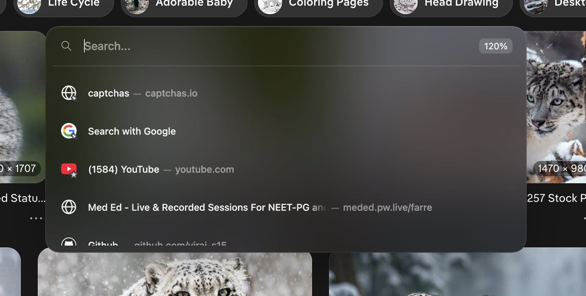

# Zen Spotlight Glass

A `userChrome.css` that makes the floating URL bar in Zen Browser look like the glass Spotlight bar in macOS. It follows the light or dark theme of the system.

Last tested on Zen 1.24.1b (Firefox 152) on macOS.

## Looks

## Install

1. Open `about:config` in Zen.
2. Set `toolkit.legacyUserProfileCustomizations.stylesheets` to `true`.
3. Set `zen.theme.acrylic-urlbar` to `true`. Without this setting, Firefox does not blur the page behind the bar.
4. Set `zen.urlbar.behavior` to `float` if you want the bar to float every time you open it.
5. Open `about:support` and click "Show in Finder" next to "Profile Folder".
6. Make a `chrome` folder in the profile folder if it does not exist.
7. Copy `userChrome.css` into the `chrome` folder. If you already have a `userChrome.css`, add this file to the end of it.
8. Quit Zen and open it again.

## Customize

Change the variables in the `:root` block at the top of `userChrome.css`.

| Variable          | Default   | What it changes                                                                                                                                      |
| ----------------- | --------- | ---------------------------------------------------------------------------------------------------------------------------------------------------- |
| `--spot-glass`    | 35% tint  | The glass color. A higher alpha makes the glass more solid.                                                                                          |
| `--spot-selected` | `#0a84ff` | The selected row. For a grey pill, use `light-dark(rgba(0, 0, 0, 0.1), rgba(255, 255, 255, 0.12))` and set `--spot-selected-text` to `currentColor`. |
| `--spot-width`    | `680px`   | The width of the bar.                                                                                                                                |
| `--spot-top`      | `22vh`    | The distance from the top of the window.                                                                                                             |
| `--spot-radius`   | `24px`    | The corner radius of the bar.                                                                                                                        |
